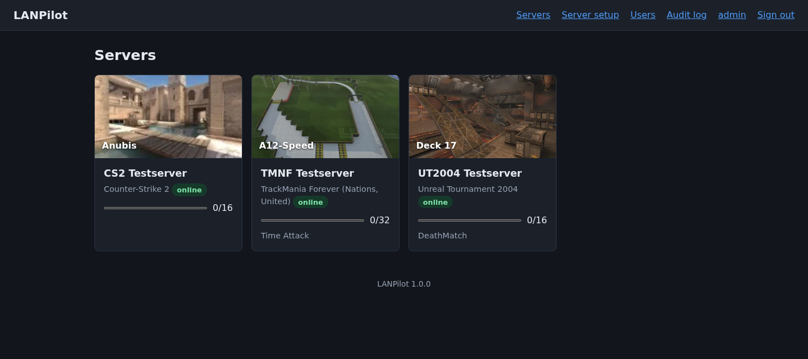
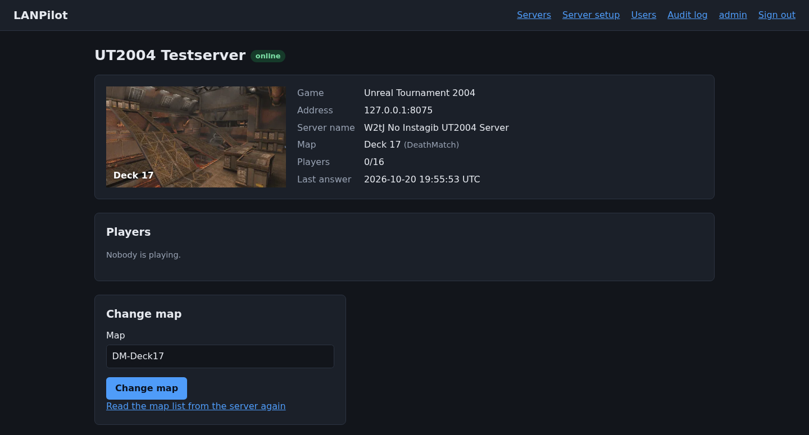

# LANPilot

A web interface for monitoring and remote-controlling game servers at LAN parties: see every
server on one dashboard, change the map, restart a match and manage players without logging
into each machine.

> **Status: 1.0.** Accounts, server management, live dashboard, map changes and
> restarts, player list with kick and ban, an optional console for administrators, map
> images (uploaded or found online), an on-demand LAN scan that finds servers without
> passwords, an English and German interface, and distribution packages. Working games:
> **Counter-Strike 1.6, Source, Global Offensive and 2**, **TrackMania Nations/United
> Forever** and **TrackMania Original/Sunrise/Nations ESWC**, and **Unreal Tournament 99,
> 2004 and 3** (player management not yet on CS2). More games come next.
> Progress is tracked in [docs/ROADMAP.md](docs/ROADMAP.md).





## What LANPilot does

- **Dashboard** with one card per server: game, current map with a preview image, player
  count and status, updated live.
- **Control** per server, as far as the game supports it: change map from a searchable list of
  the maps installed on that server, soft restart (restart the round or match), hard restart
  (reload the level), player list with kick and ban, and a raw console for administrators.
- **LAN scan** on request: finds the game servers in the configured networks without
  passwords and adds them with a pre-filled form.
- **Map images** fetched from community sources, cached locally and pre-loadable for LAN
  parties without internet access.
- **Accounts** with username and password, three roles (admin, operator, viewer) and an audit
  log of every action.
- **Interface in English and German**, chosen per user or by the browser.
- **Monitoring-only mode** for games that offer no remote control at all (planned).
- **Packages** for Debian/Ubuntu (`.deb`), Fedora/RHEL (`.rpm`) and Arch Linux.

## Design principles

- **Protocol-only.** LANPilot talks to game servers exclusively through their own remote
  protocols (RCON, XML-RPC, WebAdmin). It needs no SSH access and no agent on the game hosts.
  The consequence: it cannot start a stopped server process or read host CPU and memory.
- **Modular.** Every game is an adapter that declares what it can do. New games can be added
  without touching the user interface, including as separately installed Python packages.
- **Secure by default.** Stored server credentials are encrypted, everything requires a login,
  and data coming from game servers is treated as untrusted. See [SECURITY.md](SECURITY.md).

## Game support

| Game | Remote protocol | State |
|---|---|---|
| Counter-Strike 1.6 | GoldSrc RCON (UDP) | **supported** ([details](docs/games/counter-strike.md)) |
| Counter-Strike: Source, CS:GO, CS2 | Source RCON (TCP) | **supported** ([details](docs/games/counter-strike.md)) |
| TrackMania Nations/United Forever, TrackMania Original, Sunrise (eXtreme), Nations ESWC | GBXRemote / XML-RPC | **supported** ([details](docs/games/trackmania.md)) |
| TrackMania 2, Trackmania (2020) | GBXRemote / XML-RPC | planned, high priority |
| Unreal Tournament 99, 2004, 3 | WebAdmin (HTTP) + GameSpy query | **supported** ([details](docs/games/unreal-tournament.md)) |
| Call of Duty 1/4/5, Quake 3, Jedi Knight | Quake 3 RCON (UDP) | planned |
| Battlefield 2, Renegade X, ElDewrito | game-specific | planned |
| Age of Empires 1/2, FlatOut 2, Stronghold Crusader, Warcraft III and others | none (monitoring only) | planned |

## Documentation

- [docs/lan-party-guide.md](docs/lan-party-guide.md) – checklist for organisers: before, during and after the event
- [docs/installation.md](docs/installation.md) – packages, first start, backup, upgrade
- [docs/configuration.md](docs/configuration.md) – all settings, accounts and roles
- [docs/reverse-proxy.md](docs/reverse-proxy.md) – Nginx, Caddy, Traefik, or none
- [docs/adapters.md](docs/adapters.md) – adding support for a game
- [docs/ROADMAP.md](docs/ROADMAP.md) – phases, numbered steps and current status
- [docs/architecture.md](docs/architecture.md) – how LANPilot is built
- [docs/security.md](docs/security.md) – threat model and residual risks
- [docs/games/](docs/games/) – protocol facts measured against real servers
- [docs/research/](docs/research/) – protocol and map image research notes
- [CONTRIBUTING.md](CONTRIBUTING.md) – development setup and contribution rules
- [SECURITY.md](SECURITY.md) – reporting vulnerabilities, security model

## Development quick start

Requires Python 3.11 or newer.

```bash
git clone https://github.com/lan-dot-party/LANPilot.git
cd LANPilot
python3 -m venv .venv
.venv/bin/pip install -e ".[dev]"
.venv/bin/pytest
```

## Related projects

- [Discord-Gameserver-Notifier](https://github.com/lan-dot-party/Discord-Gameserver-Notifier) –
  discovers game servers on the LAN and announces them on Discord (read-only).

## License

[MIT](LICENSE). Third-party material and code provenance are listed in [NOTICE.md](NOTICE.md).
